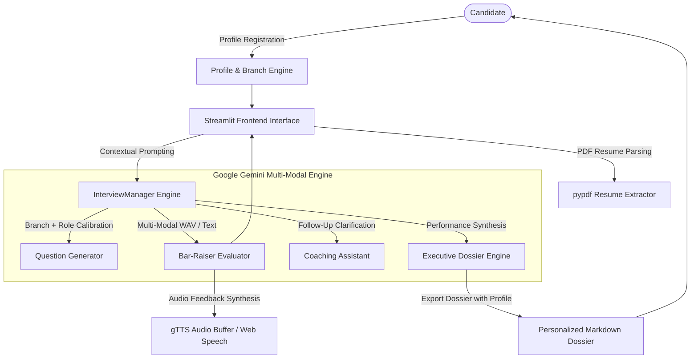

# ⚡ Elevate AI — Principal Technical Interview Coach

[](https://streamlit.io)
[](https://www.python.org/downloads/)
[](https://aistudio.google.com/)
[](https://opensource.org/licenses/MIT)
[]()

> **Elevate AI** is an enterprise-grade technical interview simulation and performance acceleration platform. Powered by Google Gemini multi-modal models, it allows candidates to register their educational degree, academic branch, and career goals, conducting branch-tailored technical mock interviews with granular bar-raiser evaluations.

---

## 📑 Table of Contents
- [Key Features](#-key-features)
- [Academic Branch & Degree Personalization](#-academic-branch--degree-personalization)
- [System Architecture](#-system-architecture)
- [Live Workflow](#-live-workflow)
- [Multi-Dimensional Evaluation](#-multi-dimensional-evaluation)
- [Quickstart & Installation](#-quickstart--installation)
- [Configuration (.env)](#-configuration-env)
- [Project Structure](#-project-structure)
- [Git Setup & Repository Management](#-git-setup--repository-management)
- [Deployment Guide](#-deployment-guide)
- [License](#-license)

---

## 🌟 Key Features

- **👤 Candidate Registration & Profile Onboarding**: Save candidate profile with Full Name, Email, College/University, Degree (`B.Tech`, `BCA`, `MCA`, `M.Tech`, `B.Sc`), and Academic Branch (`CSE`, `IT`, `ECE`, `AI/DS`, `EEE`, `Mechanical`, etc.).
- **🎓 Academic Branch-Adaptive Questions**: Automatically connects your academic discipline with the target job role (e.g. testing core OS/DBMS/DSA for CSE; low-level architectures & network protocols for ECE; mathematical intuition & inference pipelines for AI/DS).
- **🎯 1-Click Role Presets**: Immediate configurations for *Campus Placement SDE, Product-Based SDE-1, Full-Stack Architect, AI/LLM Engineer, and DevOps/SRE*.
- **📄 Resume Contextualization**: Automatically parses PDF resumes using `pypdf`, aligning technical questions with the candidate's actual projects, stack, and seniority.
- **🎙️ Multi-Modal Response Engine**: Candidates can submit responses through:
  - 📝 **Verbal/Narrative Explanation**
  - 💻 **Syntax-highlighted Code & Architectural Snippets**
  - 🎙️ **Direct Microphone Voice Recording (WAV multi-modal audio)**
- **📊 Bar-Raiser Multi-Metric Scoring**: Real-time evaluation across **Accuracy**, **System Depth**, **Clarity**, and **Industry Terminology**.
- **🔊 Interactive Audio Feedback**: Integrated text-to-speech synthesized through browser SpeechSynthesis and `gTTS`.
- **💬 Elevate Follow-Up Chat**: Candidates can challenge ratings, inquire why they lost points, or ask for senior-level rephrasing in a threaded conversational assistant.
- **📈 Executive Dossier & Learning Path**: Synthesizes a hiring recommendation (*Strong Hire, Hire, Borderline, Needs Polish*) and generates an exportable Markdown dossier with candidate credentials.

---

## 🎓 Academic Branch & Degree Personalization

Elevate AI customizes interview questions based on the candidate's degree and discipline:

| Academic Branch | Example Tailored Focus for Software Roles |
| :--- | :--- |
| **Computer Science (CSE / IT)** | Operating Systems (kernel vs user space), DBMS concurrency & indexes, System Design, DSA complexity. |
| **Electronics & Comm (ECE / EEE)** | Low-level architecture, C/C++ memory models, Embedded Systems / IoT bridging with backend cloud systems. |
| **Data Science & AI (AI/DS)** | Model pipelines, RAG latency bottlenecks, Vector search indices, Data structures for ML algorithms. |
| **Core Engineering (Mech/Civil to Tech)** | Fundamental logical reasoning, Clean Code practices, OOP abstractions, and transition motivation. |

---

## 🏛 System Architecture



---

## 🔄 Live Workflow

1. **Candidate Onboarding**: Enter your Name, Email, University, Degree (`B.Tech`, `BCA`, `MCA`, etc.), and Branch (`CSE`, `IT`, `ECE`, etc.).
2. **Profile Setup**: Choose a role preset (or customize your own), define target company and difficulty level, and optionally upload a PDF resume.
3. **Dynamic Generation**: Gemini creates targeted technical questions bridging your academic foundation and target job requirements.
4. **Candidate Response**: Listen to the question via native speech, write an explanation, paste code/schemas, or record voice via microphone.
5. **Real-time Critique**: Receive immediate multi-metric ratings, positive highlights, exact omissions, an exemplary 10/10 response, and recommended study terms.
6. **Dossier & Learning Path**: Once completed, generate the Executive Assessment and download your complete candidate dossier.

---

## 🚀 Quickstart & Installation

### 1. Prerequisites
- Python **3.10** or higher
- A Google Gemini API key ([Get a free key here](https://aistudio.google.com/app/apikey))
- Git installed on your machine

### 2. Set Up Virtual Environment (Recommended)
```bash
# Windows PowerShell
python -m venv .venv
.\.venv\Scripts\activate

# macOS / Linux
python3 -m venv .venv
source .venv/bin/activate
```

### 3. Install Dependencies
```bash
pip install -r requirements.txt
```

### 4. Configure Environment
Create a `.env` file from `.env.example`:
```bash
# Windows
copy .env.example .env

# macOS / Linux
cp .env.example .env
```
Open `.env` and set your key:
```env
GEMINI_API_KEY="AIzaSyYourGeneratedGeminiKey..."
```

### 5. Launch the Application
```bash
streamlit run app.py
```
The application will open in your default browser at `http://localhost:8501`.

---

## 📁 Project Structure

```
elevate-ai-coach-main/
├── .devcontainer/           # DevContainer definition for GitHub Codespaces/VSCode
├── .streamlit/              # Streamlit server and theme configurations
│   └── config.toml
├── .env.example             # Safe template for environment variables
├── .gitignore               # Excludes secrets, venv, and binary artifacts
├── app.py                   # Streamlit Frontend application & design system
├── interview_manager.py     # Backend AI service layer, scoring & Gemini logic
├── requirements.txt         # Pinned production Python dependencies
└── README.md                # Comprehensive documentation
```

---

## 🐙 Git Setup & Repository Management

To initialize this project under your own GitHub repository:

```bash
# 1. Initialize local repository
git init

# 2. Stage all files
git add .

# 3. Create your initial commit
git commit -m "feat: complete candidate registration and branch-adaptive mock interview"

# 4. Rename default branch to main
git branch -M main

# 5. Link to your personal GitHub repository
git remote add origin https://github.com/<YOUR_USERNAME>/<YOUR_REPOSITORY_NAME>.git

# 6. Push code to your repository
git push -u origin main
```

---

## 📄 License
This project is licensed under the [MIT License](LICENSE).
